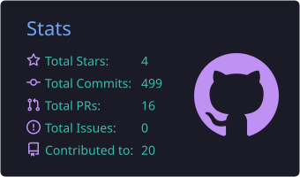
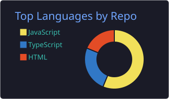
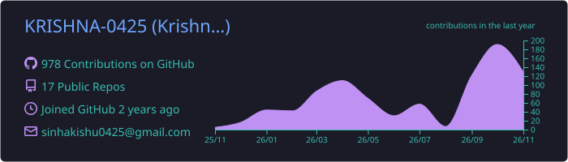

<!-- ===================================================== -->
<!--                    PROFILE HEADER                     -->
<!-- ===================================================== -->

<h3>Full Stack Developer | MERN Stack | Backend Engineering</h3>

Building scalable web applications, intelligent systems
and meaningful digital experiences.

---

<!-- ===================================================== -->
<!--                       ABOUT ME                        -->
<!-- ===================================================== -->

## 👨‍💻 About Me

I'm **Krishna Sinha**, a Full Stack Developer from India passionate about building scalable applications and solving real-world problems through technology.

🔭 Currently building full-stack applications using the **MERN stack**.
🤖 Exploring **AI Agents, LangChain, LangGraph and LLM integrations**.
🌱 Learning **Next.js, React Native and System Design**.
💡 Interested in backend architecture, distributed systems and scalable applications.
🛠️ Experienced with REST APIs, authentication, database design and third-party integrations.
💬 Ask me about React, Node.js, Express, MongoDB, TypeScript and AI integrations.
📫 Reach me at **[krishnasinha0425@gmail.com](mailto:krishnasinha0425@gmail.com)**.

---

<!-- ===================================================== -->
<!--                      TECH STACK                       -->
<!-- ===================================================== -->

## 🛠️ Tech Stack & Tools

### Frontend Development

### Backend Development

### DevOps & Development Tools

---

<!-- ===================================================== -->
<!--                   FEATURED PROJECTS                   -->
<!-- ===================================================== -->

## 🚀 Featured Projects

<table>
<tr>
<td width="50%" valign="top">

### 🤖 Prepper AI

**AI-Powered Interview Preparation Platform**

A full-stack platform designed to help candidates prepare for technical interviews through intelligent mock interviews and resume intelligence.

**Highlights**

AI-powered mock interviews
Resume analysis and parsing
Personalized interview sessions
Credit management system
Performance analytics

**Tech Stack:** React, Redux Toolkit, Node.js, Express, MongoDB, Firebase and AI APIs.

</td>
<td width="50%" valign="top">

### 🎨 Designing.io

**System Architecture Design Sandbox**

A full-stack application inspired by Eraser.io that allows users to visually design and organize system architectures.

**Highlights**

Interactive architecture canvas
Custom React Flow nodes
Automatic layout using ELK.js
Contextual Markdown notes
Authentication and persistent storage

**Tech Stack:** React, Node.js, Express, MongoDB, Zustand, React Flow, ELK.js and Tailwind CSS.

</td>
</tr>
</table>

---

<!-- ===================================================== -->
<!--                   GITHUB ANALYTICS                    -->
<!-- ===================================================== -->

## 📊 GitHub Analytics

<!-- ===================================================== -->
<!--                 CONTRIBUTION ACTIVITY                 -->
<!-- ===================================================== -->

## 📈 Contribution Activity

---

<!-- ===================================================== -->
<!--                  CONTRIBUTION SNAKE                   -->
<!-- ===================================================== -->

## 🐍 Contribution Snake

<picture>
<source media="(prefers-color-scheme: dark)" srcset="https://raw.githubusercontent.com/KRISHNA-0425/KRISHNA-0425/output/github-contribution-grid-snake-dark.svg"/>
<source media="(prefers-color-scheme: light)" srcset="https://raw.githubusercontent.com/KRISHNA-0425/KRISHNA-0425/output/github-contribution-grid-snake.svg"/>

</picture>

---

<!-- ===================================================== -->
<!--                     CONNECT WITH ME                  -->
<!-- ===================================================== -->

## 🤝 Connect With Me

---

### 💡 Building. Learning. Improving. Repeating.

**Thanks for visiting my profile!**

